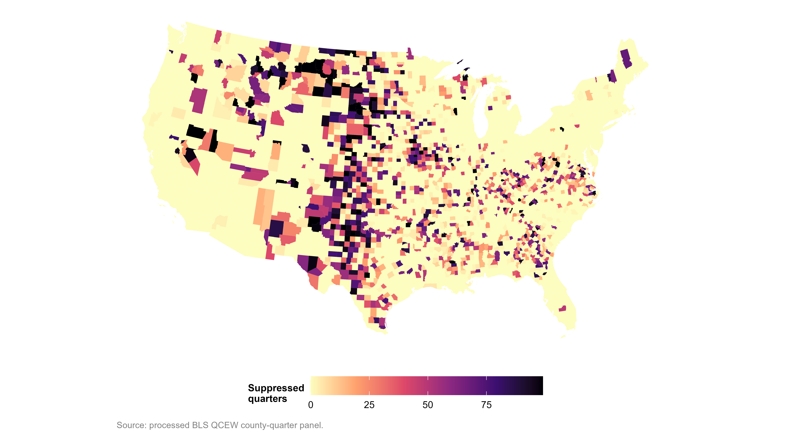
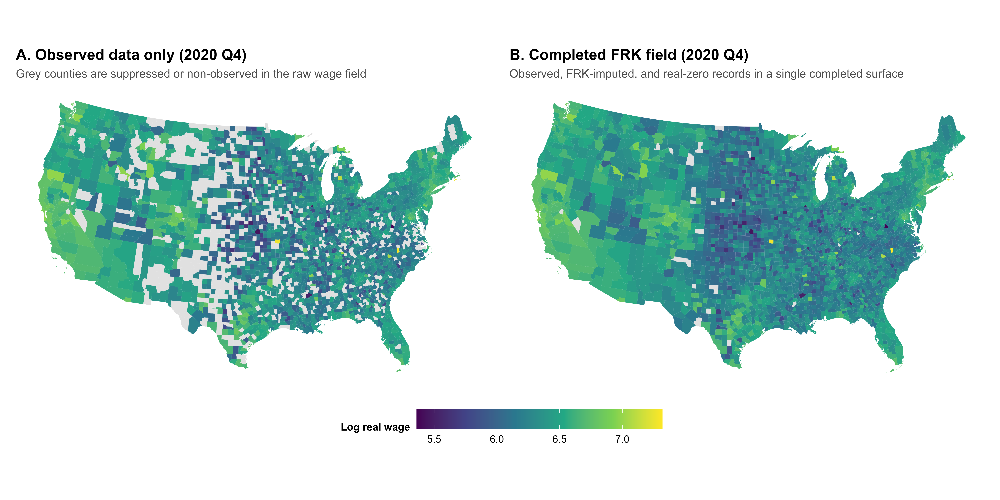
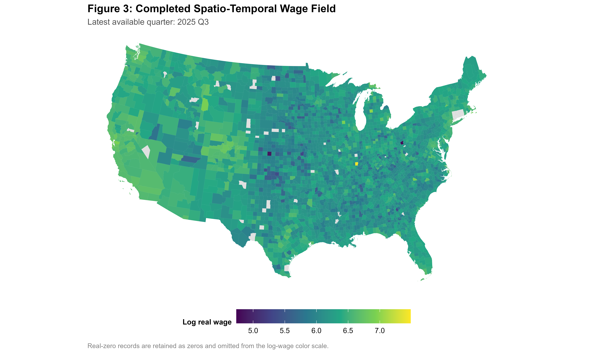
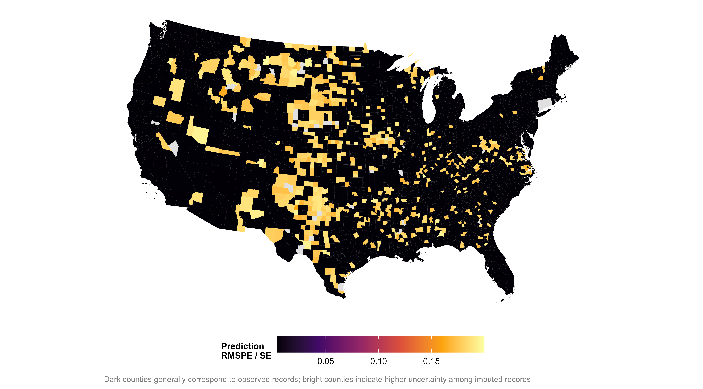
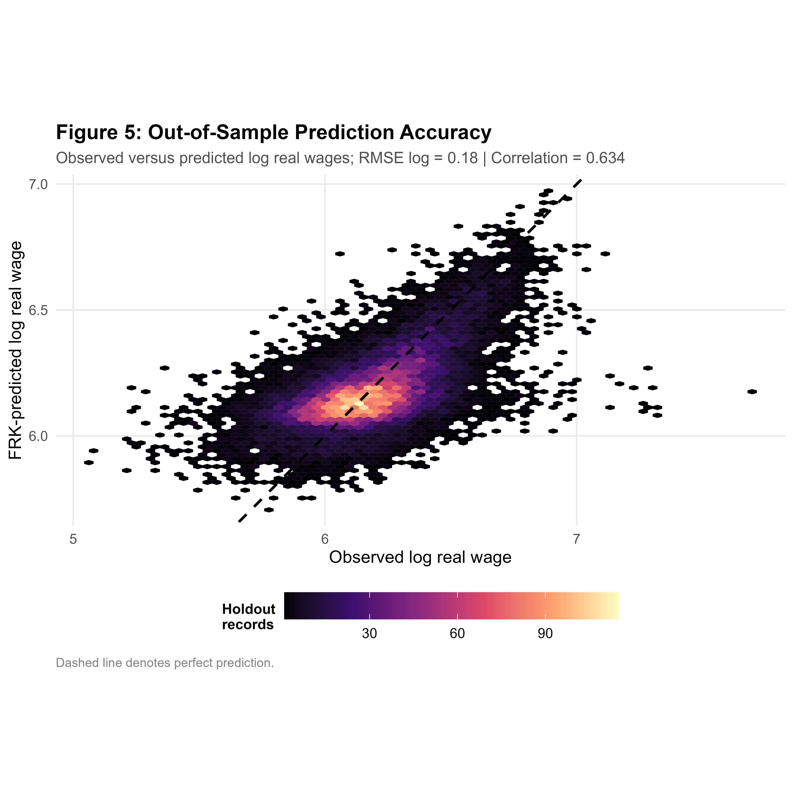
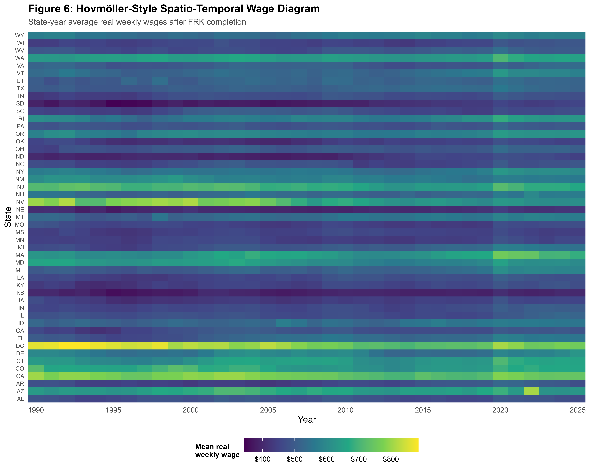

# Methodological appendix

NAICS 445, food and beverage stores; county-quarter QCEW wage records; CONUS; 1990-2025 Q3.

This appendix documents the main methodological decisions behind the workflow: the data problem, the FRK specification, the validation design, and the diagnostic figures generated after model fitting.

The empirical application uses county-quarter QCEW wage records for NAICS 445, food and beverage stores. The objective is to complete wage records suppressed for disclosure reasons while keeping observed wages and real-zero records separate. This distinction is central: the model predicts suppressed wages, but it does not convert true zero activity into missing wage observations.

## 1. Data problem

QCEW data are useful for regional labor-market research because they provide employment and wage information at fine geographic and temporal scales. The difficulty is that some wage values are not published. These suppressions are part of the disclosure-protection system, so they should not be handled as ordinary blanks in a spreadsheet.

Before modelling, the script separates the panel into three groups:

- observed wage records;
- suppressed wage records used as prediction targets;
- real-zero records, retained as zeros and excluded from interpolation.

This classification is a small step in the code, but it carries much of the methodological discipline of the project. If suppressed records and real zeros are mixed together, the model would be asked to solve the wrong problem. Suppression is not treated as a set of unrelated spreadsheet blanks. The empirical diagnostic in Figure 1 shows that missingness is spatially uneven, which motivates a spatio-temporal prediction approach.

## 2. Spatial suppression pattern

The first diagnostic question is where suppression occurs repeatedly. Figure 1 maps cumulative suppression intensity across counties. The purpose of this figure is not only descriptive. It also checks whether the missingness problem has spatial structure, which supports treating the panel as a spatio-temporal prediction problem rather than as a set of unrelated missing cells.

<strong>Figure 1.</strong> Cumulative suppression intensity by county across the study period.

The map shows that suppression is spatially uneven. Some areas accumulate many suppressed quarters, while others have much more complete wage histories. This unevenness is one reason the workflow treats geography as part of the information set.

## 3. Model specification

The workflow uses Fixed Rank Kriging through the `FRK` package in R. The modelling strategy follows the logic of Spatial Random Effects models for large spatial and spatio-temporal datasets, where a full covariance approach would be computationally unattractive at this scale (Cressie & Johannesson, 2008; Zammit-Mangion & Cressie, 2021).

The observed modelling variable is the log real weekly wage used by FRK:

$$
z_i = \log(W^{real}_{s_i,t_i}) = Y(s_i,t_i) + \epsilon_i,
$$

where \(z_i\) is the observed log real weekly wage for county-location \(s_i\) and quarter \(t_i\), \(W^{real}_{s_i,t_i}\) is the CPI-deflated real weekly wage, \(Y(s,t)\) is the latent spatio-temporal wage process, and \(\epsilon_i\) is measurement error.

The latent process is represented as:

$$
Y(s,t) = \beta_0 + \mathbf{g}(s,t)^\top \boldsymbol{\eta} + \xi(s,t).
$$

Here, \(\beta_0\) is the global intercept because the production model uses `z ~ 1`; \(\mathbf{g}(s,t)\) is the vector of spatio-temporal basis functions; \(\boldsymbol{\eta}\) is the vector of random effects; and \(\xi(s,t)\) captures fine-scale variation. This notation separates the observed data, the latent process, the basis representation, and the measurement component.

The production run uses 141 spatial bisquare basis functions and seven temporal bisquare basis functions, yielding 987 spatio-temporal basis functions. The model is fit with `response = "gaussian"`, `f = z ~ 1`, `K_type = "precision"`, and `est_error = FALSE`. Measurement-error standard deviation is fixed at 2% of the observed standard deviation of log real wages, so measurement error is treated as small relative to process variation rather than estimated freely.

In the production run, the Spatial Random Effects model is estimated with TMB and a sparse precision-matrix parameterization. TMB is used for likelihood-based estimation with automatic differentiation and Laplace approximation (Kristensen et al., 2016). This setup makes the spatio-temporal model feasible for a large county-quarter panel without treating imputed values as if they were directly observed data. The newer FRK implementation also supports this type of large spatial and spatio-temporal modelling framework (Sainsbury-Dale et al., 2024).

## 4. Before and after completion

Figure 2 shows the practical effect of the prediction step. The left panel represents the observed wage surface with suppressed values unavailable. The right panel shows the same period after completing the suppressed records through FRK prediction. This comparison makes the applied contribution visible before moving to validation statistics.

<strong>Figure 2.</strong> Observed and FRK-completed wage surfaces for the quarter with the largest wage gap.

The figure should be read as a diagnostic display. It shows how the completed surface restores spatial continuity, but it does not by itself prove that the predictions are accurate. That role is taken by the holdout validation in Section 7.

## 5. Completed wage field

After the imputation step, the workflow produces a complete county-quarter wage field for the analysed panel. Figure 3 presents the completed log real wage field for the latest available quarter. The figure shows the final object produced by the workflow: a spatially complete wage surface that still preserves the distinction between observed and imputed values in the underlying data.

<strong>Figure 3.</strong> Completed log real wage field for the latest available quarter.

The map does not replace county-level data inspection. It gives a compact view of the completed field and helps assess whether the broad spatial pattern is plausible after the imputation step.

## 6. Prediction uncertainty

Point predictions are not enough for this type of work. Imputed wages should carry uncertainty, especially when they may later be used in empirical models. Figure 4 reports the prediction uncertainty produced by the FRK workflow for the latest available quarter.

<strong>Figure 4.</strong> FRK prediction uncertainty for the latest available quarter.

The uncertainty map is important for interpretation. Areas with larger uncertainty should be treated with more caution in downstream descriptive or econometric work. In that sense, the workflow does not only fill the panel; it also records where the completed values are less precise.

## 7. Holdout validation

Point predictions alone do not establish whether the uncertainty surface is well calibrated. The holdout exercise addresses this question by withholding a stratified sample of observed wages, refitting the model, and comparing predictions with held-out observations. Figure 5 shows the resulting relationship between observed and predicted log real wages in the holdout sample.

<strong>Figure 5.</strong> Observed versus FRK-predicted log real wages in the holdout sample (hexbin density plot, n = 17,880 county-quarter observations). The dashed line denotes perfect prediction.

The validation results are summarized in Table 1. These statistics should be read as a validation audit for the imputation workflow, not as a final substantive result about the wage structure of the sector. The corresponding generated tables are written to `3_Outputs/4_Tables/`.

**Table 1. Summary of the completed CONUS panel and holdout validation results.**

| Quantity | Value |
|:---|---:|
| CONUS records used in the completed panel | 412,437 |
| Observed wage records | 358,984 |
| Suppressed target records imputed | 50,695 |
| Real-zero records | 2,758 |
| Holdout observations | 17,880 |
| RMSE, log real wage | 0.1803 |
| MAE, log real wage | 0.1364 |
| Bias, log real wage | -0.0017 |
| Correlation, log real wage | 0.6344 |
| Empirical 95% interval coverage | 94.79% |

The RMSE of 0.1803 is measured on the log real-wage scale. As a rough interpretation, this corresponds to an average prediction error on the order of 18 log points, not to a dollar-denominated wage error. The small mean bias and empirical 95% coverage close to 95% support the calibration of the workflow for imputation, while the moderate correlation indicates that county-quarter wage prediction remains noisy in a heterogeneous national panel.

Both the main model and the validation model reported convergence code 0 with the `nlminb` message `relative convergence (4)`: 55 iterations for the main model and 65 iterations for the validation model.

## 8. State-year overview

Once the panel is completed, it can be aggregated to inspect broader temporal patterns. Figure 6 provides a state-year overview of completed real weekly wages. The figure is useful as a diagnostic summary because it can reveal broad changes over time and possible state-year observations that deserve closer inspection.

<strong>Figure 6.</strong> State-year overview of completed real weekly wages.

### Arizona 2022 audit

The state-year overview in Figure 6 identifies Arizona in 2022 as a high-leverage observation. A post-run audit shows that this pattern is driven by Greenlee County, Arizona (FIPS 04011), where the completed real weekly wage is unusually high in 2022 Q1-Q3. The corresponding generated audit tables are written to `3_Outputs/4_Tables/`.

| County | Year | Quarter | Completed real weekly wage | Record status |
|---|---:|---:|---:|---|
| Greenlee County, AZ | 2022 | Q1 | 4,652.51 | Observed |
| Greenlee County, AZ | 2022 | Q2 | 3,546.76 | Observed |
| Greenlee County, AZ | 2022 | Q3 | 3,773.77 | Observed |

These records enter the completed panel as observed QCEW records, not as FRK-imputed targets. The Arizona 2022 state-year value is therefore a source-data outlier preserved by the workflow, not an interpolation artifact.

This distinction matters for interpretation. The outlier affects the unweighted Arizona state-year average shown in Figure 6, but it does not indicate a failure of the FRK imputation procedure. Users working with state-level aggregates should treat Arizona 2022 with caution and may consider median aggregation, winsorized means, or sensitivity checks excluding high-leverage observed county-year records.

## 9. Reproducibility checks

The script includes checks before and after model fitting:

- column-count checks during import;
- duplicate key checks for county-quarter records;
- CPI coverage checks before deflation;
- observed, target, and real-zero classification checks;
- FIPS remapping and geometry matching checks;
- BAU and basis-function coverage checks;
- model convergence checks;
- missing prediction checks after imputation;
- validation by year and by quarter.

These checks are included because small data-handling errors can become difficult to detect after model fitting. The objective is to make the workflow auditable: a reader should be able to trace how the raw QCEW files become a completed wage panel.

## 10. Methodological limits

The workflow should be understood as a reproducible imputation procedure, not as a causal model. It completes suppressed wage records by borrowing information across space and time under the FRK specification. The completed panel can support later empirical work, but those later analyses still require their own identification strategy, diagnostics, and robustness checks.

Three limitations are especially relevant:

1. The workflow is designed for NAICS 445 and the contiguous United States. Applying it to other sectors or geographies requires checking the filters, panel structure, and spatial support again.
2. The FRK specification imposes a structured spatio-temporal dependence model. This is useful for scalability, but it remains a modelling assumption.
3. Imputed values should be documented as imputed in downstream use. They should not be silently treated as original QCEW observations.

Downstream empirical work should retain an imputation indicator, propagate uncertainty where feasible, and run sensitivity checks that distinguish observed from imputed wage values. These limits do not weaken the workflow; they make its scope explicit.

## References

Cressie, N., & Johannesson, G. (2008). Fixed rank kriging for very large spatial data sets. *Journal of the Royal Statistical Society: Series B (Statistical Methodology), 70*(1), 209-226. https://doi.org/10.1111/j.1467-9868.2007.00633.x

Kristensen, K., Nielsen, A., Berg, C. W., Skaug, H., & Bell, B. (2016). TMB: Automatic differentiation and Laplace approximation. *Journal of Statistical Software, 70*(5), 1-21. https://doi.org/10.18637/jss.v070.i05

Sainsbury-Dale, M., Zammit-Mangion, A., & Cressie, N. (2024). Modeling big, heterogeneous, non-Gaussian spatial and spatio-temporal data using FRK. *Journal of Statistical Software, 108*(10), 1-39. https://doi.org/10.18637/jss.v108.i10

Zammit-Mangion, A., & Cressie, N. (2021). FRK: An R package for spatial and spatio-temporal prediction with large datasets. *Journal of Statistical Software, 98*(4), 1-48. https://doi.org/10.18637/jss.v098.i04
